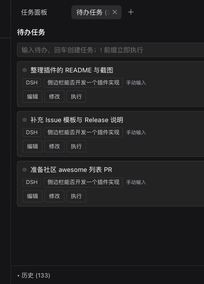

# dsh-ui-taskcards

<p align="center">
  <a href="https://github.com/ydlly224/dsh-ui-taskcards"></a>
  
  
  <a href="https://github.com/topics/dsh-plugin"></a>
</p>

<p align="center"></p>

DSH（DeepSeek Harness）Web UI 的插件（客户端 bundle + 宿主半边）：**官方右侧栏原生标签页「待办任务」**（`sidebarRightTabs` 注册类型 + `sidebar.right.pane.tab` 槽位，与「工作区文件/浏览器/终端」同一套 dock 体验：可拖拽分栏、全屏、宽度拖拽、会话级布局记忆）+ 输入框固定按钮（`conversation.composer.dock`）。

> 兼容性：DSH Web 0.1.x ~ 0.2.x（依赖官方 `sidebarRightTabs` 服务与 `sidebar.right.pane.tab` 槽位；在 **0.2.1-rc.5** 上完整实测通过：建卡/读卡/撤回/派发/修改/顺序执行面板，右侧栏注册已改为 `ctx.inject(['sidebarRightTabs'])` 时序安全写法）。纯客户端 bundle，无 npm 依赖。

## 功能

- **采集（默认关闭）**：面板头部「采集开 / 采集关」开关控制是否把会话 todos 自动转卡（source=agent-todo）。开启后**只为本标签页所属会话建卡**（多标签/多窗口不会把别的标签页会话的 todo 误建成卡）；关闭时不会创建任何 todo 卡，载入/跨窗口同步会剔除活动列表中的 todo 卡（历史归档保留），已有卡片仍按 todo 状态同步（in_progress→running、completed→done、移除→stale）；卡片执行状态随 todos 自动同步（`in_progress`→`running`、`completed`→`done`，已入列/运行中的卡片不会被降级回待执行），且跨会话也能同步（非当前会话只同步已有卡片状态与失效标记）；输入框 📌 按钮固定草稿转卡（composer-pinned，不发送不清草稿）；面板快捷输入建卡（panel-input，`!` 前缀立即执行，多行粘贴逐行建卡）
- **卡片**：每张卡显示**建卡来源**（「建卡：<会话标题>」徽标，悬停可看建卡会话 id 与创建时间；通知卡=发起通知的会话，todo 卡=其所属会话，输入框/📌/导入=当时当前会话）、编辑（标题/派发指令）、修改（工作区/会话/定时/顺序执行成员，仅 pending 可改目标）、执行（`sessions.prompt` mode=queue）；**回合观察器回写**（手动执行的卡：会话 running→`running`，回合结束且收件队列空→`done` 并自动归档；从未观察到 running 时需满 15s 快速回合窗口；目标会话消失 45s 后置 `failed`）；工作区/会话徽标（会话徽标点击 `uiWorkspace.openSession` 跳转）；拖拽 + ↑↓ 排序；终态自动归档（历史区可恢复/删除）
- **定时**：本地 30s 心跳调度器；设置定时时前置校验目标；到期派发后清除；补触发复用 requestId 幂等；到期目标失效即转 failed（防心跳反复拾起）；单轮心跳最多 3 张
- **顺序执行**：每会话一台状态机（idle/dispatching/waiting-running/waiting-interaction/advancing/stopped）；复合轮次结束判定（running=false 且收件队列空，队列不可探测时降级为 3s 连续空闲）；pendingInteraction 暂停 + 10s 恢复计时；批次内同工作区复用新建会话（`seqIsolatedSessions` 可切逐卡新建）；连续 3 张 blocked 即停止；顺序执行开关（⛓）默认关闭且不持久化（每次打开页面需手动开启）；由会话 todos 自动捕获的卡片默认不加入顺序执行队列，可在「修改」中显式加入；跨窗口存储同步时会立即停止本窗口在途的顺序执行批次
- **目标解析**：会话存活→直接派发+归属自愈；无会话有工作区→`sessions.create({workspaceId})` 新建并回写；否则拦截引导设置工作区
- **幂等**：write-ahead lastDispatch + requestId 单飞检查；跨窗口 storage 事件同步
- **会话通知（agent 工具）**：宿主半边注册 agent 工具 `taskcard_notify(target, content)`、`taskcard_delete` 与会话投影 `taskcards`（**仅主代理会话可调用**：`delegationDepth = 0`，含 fork 出来的主会话；子代理 `delegationDepth ≥ 1` 会被拒绝并提示回报主代理）。任意会话的 agent 调用该工具后，本插件自动生成一张**已预设目标会话/工作区**的待办任务卡（来源标记「会话通知」，默认不加入顺序执行），用户只需在面板点一次【执行】即把任务投递到目标会话；`target` 支持标题**模糊匹配**（精确/前缀/包含）、「工作区-会话」复合写法或会话 id 前缀/包含（**不提供反向包含**）；同名会话**优先在通知来源会话所属工作区**内解析，未命中时生成未绑定目标的卡片（可预填工作区）并提示手动指定。**该能力需要重启一次 dsh web 加载宿主半边**（客户端部分刷新页面即可）
- **入口（方案 B）**：右侧栏「+ 新标签页 → 待办任务」添加（引导入口），打开后与文件/浏览器面板同款 dock 行为；面板内创建任务默认绑定该标签页所属会话；旧的 shell.overlay 抽屉已移除

## 文件

| 文件 | 说明 |
| --- | --- |
| `package.json` | dsh.client.inject：locale / ui-conversation / ui-primitives / ui-workspace |
| `cordis.patch.yml` | bundle patch（宿主注册工具 `taskcard_notify` 与会话投影 `taskcards`） |
| `lib/index.js` | 宿主半边：注册 agent 工具 `taskcard_notify` / `taskcard_delete` + session projection `taskcards`（零 npm 依赖；投影 state `{notices, deletions}`，schema 用 pass-through，运行时只用到 `.parse`） |
| `lib/client.js` | 浏览器 bundle（ModuleLoader CJS 工厂，单文件 region 分区） |

## 会话通知（agent 工具 `taskcard_notify` / `taskcard_delete`）

半自动跨会话投递：让某个会话的 agent 把任务「投」给另一个会话。

1. 会话 A 的 agent 调用工具：
   ```json
   { "target": "部署会话", "content": "任务A：升级 staging 并回报结果" }
   ```
   `target` 也支持模糊写法与会话 id 片段（前导 `#` 会被剥离）。

   **目标解析规则**（每层必须唯一命中，歧义自动降级；先在本工作区跑完全部层级，再跨工作区）：

   | 层 | 规则 | 示例 |
   | --- | --- | --- |
   | T1 | 标题精确（忽略大小写/首尾空白） | `部署会话` |
   | T2 | 标题前缀 | `部署` → `部署会话` |
   | T3 | 标题包含 | `部署` → `RG-部署会话（生产）` |
   | T5 | 会话 id 前缀 | `7bb53fb7` / `session-7bb5` |
   | T6 | 会话 id 包含 | `7bb537` |

   另外支持**「工作区-会话」复合写法**（分隔符可用 `-` `_` `·` 或空格，取最长工作区前缀，**切分点只能落在分隔符上**）：例如 `Centauri-主线` = 先在 `Centauri` 工作区里找「主线」会话；工作区匹配但会话找不到时**不会回退全局**，直接生成未绑定卡片（避免误绑到同名/短标题会话），并且该卡片会**预填这个工作区**——「修改」里可直接选该工作区会话，或走「执行时新建会话」。工作区标题本身含分隔符（如 `权小赚DSH- Native-发布线`）时按最长前缀切分。

   注：纯会话 id（如 `session-7bb5`）不会被当作复合引用；不含分隔符的粘连写法（如 `CentauriX-主线`）也按常规路径处理。

   注：**不提供反向包含**（`输入 ⊃ 标题`）匹配，避免短标题会话（如 `Centauri`）把 `Centauri-主线` 这类复合引用误判为命中。

   全部层都无法唯一确定时，卡片仍会创建但**不绑定目标会话**（标题带 `→ 目标：` 前缀），由你在「修改」里手动指定。
2. 【待办任务】面板自动出现一张卡片：标题/派发文本 = `content`，**执行会话/工作区已预设为 target 对应会话**，来源「会话通知」，默认不参与顺序执行。
3. 你在面板点一次【执行】→ 任务以用户消息形式投递到目标会话（queue 模式，目标忙时排队），卡片状态随后按回合观察器更新（queued → running → done）。

实现要点：工具通过官方 `appendPluginRecord` 向调用方会话写入**插件记录事件**（带 `ignorable` 标记，宿主重启后仍可正常加载；不会因未知事件类型拒读会话日志）；宿主投影 fold 成 `{ notices: [...], deletions: [...] }`（notices ≤20、deletions ≤50），并**同时兼容旧事件类型** `taskcards/notify`（历史会话的卡片照常显示）；客户端从 `projectionValues.taskcards` 消费并去重（`noticeSeen` / `deletionSeen` 持久化），因此刷新页面不会重复建卡/重复删卡。

> 通知正文长度：`taskcard_notify` 的单卡正文上限为 **20000 字符**（原 4000 已放宽）；超过上限时不再静默截断，而是在正文末尾追加「…（内容过长已截断：原文 N 字，上限 20000 字）」。`taskcard_delete` 的 content 上限同步为 20000，保证任何能建出的卡都能按内容删除。
>
> 双窗口（同时打开两个 DSH Web 界面）：卡片执行状态改为**显示层派生**——`queued/running` 卡片只要目标会话正在运行就显示 running（闪烁），因此两个窗口都会闪；跨窗口同步改为**按卡片 `updatedAt` 合并**（旧窗口的过期状态不会把 running 覆盖回 pending/queued）。**派发（含【顺序执行】与定时）不受租约限制**：任何窗口都能派发，防重复派发依赖 write-ahead `in-flight` + requestId 幂等；localStorage 心跳租约（2s 心跳 / **60s 超时** / 正常关窗即时释放）只负责「状态落盘与 done 判定」的唯一写者，切到后台的标签页不会因定时器节流被抢走租约；点【顺序执行】时当前窗口立即接管写者身份，`seqMode` 以本地窗口为准、**不会被另一窗口的同步写覆盖关掉**。
>
> 采集开关：`autoCapture` 默认 `false`（持久化，面板头部切换）。关闭时新 todo 不建卡，且载入/跨窗口同步会剔除活动列表里的 todo 卡，避免旧标签页写回造成反复出现。
>
> 删除对账：载入时会把已应用的删除指纹（`deletionSeen`）与现存卡片再对账一次（id 支持唯一前缀、content 精确）——旧版本因短 id 未匹配而残留的「已撤回卡」会在升级后自动清除。
>
> 去重锚点：`noticeSeen` 上限 5000 条（必须大于通知总数，否则窗口外的旧通知会被当成新通知反复建卡）；建卡前会同时查活动卡与归档卡的 `diffKey`，命中即跳过；载入时还会从活动/归档里已有的 `notify:*` 卡片补齐 `noticeSeen`，升级后无需手工清理即可阻止旧卡重生。

### 删除卡片（`taskcard_delete`）

Agent 可删除自己创建的错误/过期卡片（活动列表与历史归档都会删）：

```json
{ "id": "<taskcard_notify 返回的 id>" }        // 删除会话通知卡
{ "content": "<todo 标题>" }                    // 删除本会话 todo 采集的卡（规范化匹配）
```

- 两个参数**二选一**；content 匹配与客户端一致（忽略大小写/标点/空白差异）；
- `id` 支持**唯一前缀**（≥4 字符）：本会话日志里恰好命中一张卡时自动补全为完整 id；命中多张会报错（不猜，请写更长前缀或完整 id）；客户端同时兼容历史「短 id 删除记录」（按前缀匹配并移除卡片）；
- **返回语义**（`status`）——不会静默成功：
  | status | 含义 | 是否写入删除记录 |
  | --- | --- | --- |
  | `deleted` | 卡片存在且未删过 → 已排入删除 | ✅ |
  | `already_deleted` | 最近一条删除记录晚于最近一次建卡 → 无需重复删 | ❌ |
  | `not_found` | 判定卡片不存在（返回 `ok:false`） | ❌ |
  | `forced` | 判定不存在但传了 `force:true` → 强制排入删除 | ✅ |
  | `submitted` | 宿主无法读取事件日志时的降级（仍写入） | ✅ |
- `force:true`（仅字面 true）用于跨会话/历史卡片：宿主的存在性判定基于**调用方会话自己的事件日志**，看不到别的会话创建的卡片时请用 force；
- 卡片被重新建出后可以再次删除（时序判定：删除记录晚于最新建卡才算 `already_deleted`）；
- 归一化后为空的内容（纯空白/纯标点）会被拒绝，避免无意义删除。

> ⚠️ `taskcard_notify` / `taskcard_delete` **仅允许主代理会话调用**（`delegationDepth = 0`，含 fork 出来的主会话）；子代理 `delegationDepth ≥ 1` 调用会报错，请把结论回报主代理，由主代理统一建卡/删卡。

> 依赖说明：`appendPluginRecord` 来自宿主自带的 `@deepseek-ai/dsh-session`（本插件不打包、不引入 npm 依赖，运行时从宿主安装目录解析；解析不到时工具会明确报错并**不会**回退成裸 `session.append`，避免再次写坏会话日志）。

> ⚠️ 宿主半边（`lib/index.js`）在 dsh web 启动时加载：**首次安装或升级含宿主改动的版本后，需要重启一次 dsh web**；仅客户端改动刷新页面即可。

## 安装

```bash
# 1) 安装包（本地目录或 Git 仓库；GitHub 简写亦可）
dsh plugin --profile web add file:<本插件目录>
#   或：dsh plugin --profile web add git+https://github.com/ydlly224/dsh-ui-taskcards.git
```

2) 在 `~/.dsh/profiles/web/package.json` 的 `dsh.profile.bundles` 数组里追加 `"dsh-ui-taskcards"`（pnpm 已把依赖写入 `dependencies`，注册 bundle 需手动加一行）；
3) 重启一次 dsh web，浏览器刷新后在右侧栏「+ 新标签页 → 待办任务」打开；此后仅改 `lib/client.js` 会自动 HMR 热重载。

纯客户端插件：无 npm 依赖、不发起网络请求、不写除 `localStorage["dsh.taskcards.v1"]` 之外的本机持久化。

## 自检

```
node --check lib/index.js   # 通过
node --check lib/client.js  # 通过
```

## 已知边界

- 定时触发需页面开启；关闭期间错过的到期卡下次打开补触发一次
- 轮次归因是会话级近似；用户排队消息会推迟顺序执行推进（不卡死不跳队）
- v1 单窗口约束（多窗口写冲突靠 storage 事件尽力同步）

## English

A pure client-side plugin for [DeepSeek Harness](https://github.com/deepseek-ai) Web UI: registers a **native right-sidebar tab** (`sidebarRightTabs`) — a **Todo Tasks** tab that captures session todos as durable cards with run / schedule / sequential execution and history.

- Repo: https://github.com/ydlly224/dsh-ui-taskcards
- Install: `dsh plugin --profile web add git+https://github.com/ydlly224/dsh-ui-taskcards.git`, then register the bundle name in `~/.dsh/profiles/web/package.json` → `dsh.profile.bundles`, restart dsh web and refresh.
- Extends: DSH Web 0.1.x ~ 0.2.x (verified on **0.2.1-rc.5**: create/read/withdraw/dispatch/edit/sequencer; right-sidebar registration now uses the timing-safe `ctx.inject(['sidebarRightTabs'])`); pure client bundle, zero dependencies.
